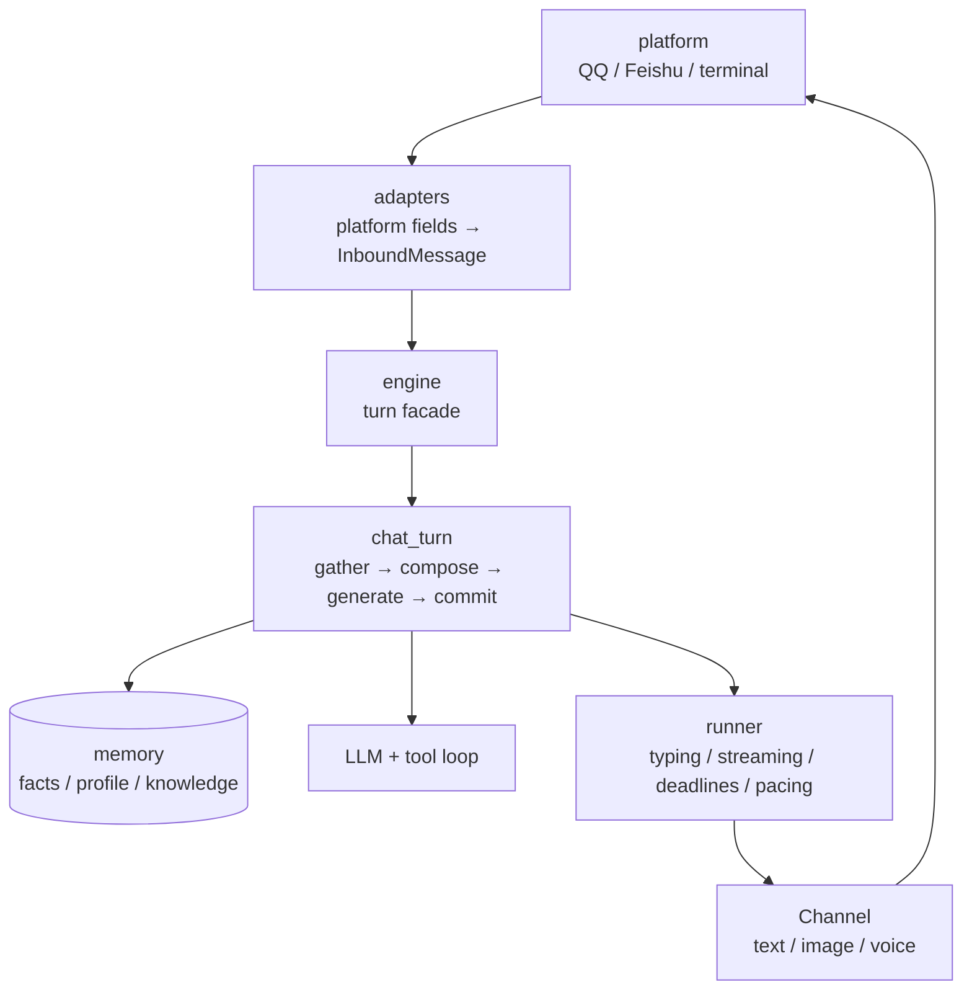

<div align="center">

# companion

**It serves exactly one person. It remembers you across months — and knows when to say nothing.**

Self-hosted · single process · local SQLite · swap the model, the channel or the memory engine — it is still *it*.

[](https://github.com/Fqh22/companion-bot/actions/workflows/lint.yml)
[](LICENSE)
[](pyproject.toml)

[Quick start](#five-minute-quick-start) · [How it works](#how-it-works) · [Add a channel](#add-a-channel) · [Docs](#docs)

> This English version may lag behind the Chinese [README.md](README.md); the Chinese one is authoritative.

</div>

> **Unofficial project**: not affiliated with Tencent, Feishu/Lark or any IM platform.
> The QQ channel relies on third-party OneBot implementations, which can break or get accounts flagged —
> use a throwaway account for personal use only. Personal WeChat is not supported.

---

## What it is

**Not "a chatbot with an LLM bolted on", and not role-play.**

The usual "AI companion" recipe is: retrieve on every turn, stuff ten memories into the prompt,
make the model sound more like it knows you. Measured on real companion traffic, that is the wrong recipe —
only about **3.4%** of messages actually need recall, and recall gating performs near chance (AUROC 0.530).
**Better retrieval does not fix "when not to retrieve".**

So judgement is the first pillar, not memory:

| | A chatbot | companion |
|---|---|---|
| Every turn | retrieve → stuff context → answer | decide first: does this need recall, a follow-up, speaking at all? |
| Where memory lives | material for the prompt | a resource called when needed; facts traceable, conflicts adjudicated |
| Talk vs silence | say more | sometimes the right move is not to answer |

Three commitments:

- **Judgement** — did it hear you, is there anything to act on, is the dose right.
- **Memory** — expression never contaminates recorded facts; it is looked up only when needed.
- **Presence** — text / voice / image / sticker are *forms*, and form carries intent.

Plus two engineering constraints:

- **Carryable** — persona, memory and relationship state export to human-readable, diffable files; change the model, channel or memory engine and it is still *it*.
- **Authorizable** — small tasks (reminders, lookups, tidying up, sending messages) can be completed, but every side effect is traceable, reversible and needs approval. No unsupervised multi-step execution.

It does **not** do: multi-tenant hosting, a plugin marketplace, a public web UI, unsupervised autonomous planning,
or "more human" silent forgetting and distortion. Full definition and trade-offs: [docs/01-定义与决策.md](docs/01-定义与决策.md) (Chinese).

---

## How it works

### One turn



- **Gather**: weather, search, follow-ups and recall run in parallel under a first-token budget.
- **Compose**: stable prefix (profile) first, history in the middle, background block (memory / notes / corrections) last —
  for cache hits, and so the prefix does not change every turn.
- **Generate**: model-first, rules only as fallback; at most 6 tool rounds, budget derived from the first-token budget.
- **Commit**: write history, side-notes ("I just sent a voice message"), shadow samples, summary watermark — order matters.

Deadlines are an implementation detail, not the definition: the 90s ceiling only stops "never finishes";
what you feel is the 10s first-token budget plus the 30s no-progress timeout.

### Memory

Two write paths: **explicit self-statements land immediately**, batch summaries every 8 turns / 40 messages / 30 idle minutes.
Facts carry source and time; conflicts **soft-delete the old fact** instead of overwriting. Old items are archived, never hard-deleted.
A weekly reflection compresses scattered facts into one *understanding* the user can contradict — the only correction path memory has.

### Channels are an adapter layer

There is no `import nonebot` inside `app_core`. A channel declares supported forms and two send primitives;
turn loop, memory, affect, pacing, deadlines, commands and scheduling are all reused.

---

## Five-minute quick start

No chat platform needed — talk to it in the terminal. **Python 3.12** (CI only tests this).

```bash
git clone https://github.com/Fqh22/companion-bot.git
cd companion-bot
python -m venv .venv && source .venv/bin/activate      # Windows: .venv\Scripts\activate
pip install -r nonebot/requirements.txt

export QQBOT_CODE_DIR=$PWD/nonebot
python ops/lint-plugins.py           # layering / style, seconds
python ops/drill-console.py          # terminal channel, temp root, touches no production data
```

To keep it running, see [Deploy](#deploy); to plug in your own platform, see the next section.

---

## Add a channel

Implement "capability declaration + send primitives", convert platform events into `InboundMessage`,
and hand the rest to `TurnRunner`:

```python
class MyChannel:
    forms = {"text", "image", "voice"}            # what this platform supports

    async def send_part(self, session: str, part) -> bool: ...
    async def typing(self, session: str, on: bool) -> None: ...

async def on_message(platform_msg):
    msg = InboundMessage(session=f"myplat:{platform_msg.user_id}",
                         text=platform_msg.text, images=platform_msg.images,
                         platform="myplat")
    await TurnRunner(engine, MyChannel(), deadline=90).run(msg)
```

QQ (OneBot v11), Feishu (self-built app, long connection) and the terminal all share the same memory and persona.
Full steps: [docs/02-系统与扩展.md](docs/02-系统与扩展.md); channel setup: [docs/03-运维与通道.md](docs/03-运维与通道.md) (both Chinese).

---

## Changing it

Layering is enforced by `ops/lint-layers.py`, not by discipline:

| Layer | Responsibility | Examples |
|---|---|---|
| **domain** | pure rules, no IO | `prompt` `pacing` `delivery` `intent` |
| **orchestration** | turn loop, commands, scheduling | `engine` `runner` `chat` `chat_turn` |
| **infra** | paths, config, files, clock | `paths` `config` `files` `kernel/*` |

Four hard constraints, each machine-checked: `app_core` never imports a platform framework;
domain never depends on orchestration; plugins only call the `core.<ns>.<func>` facade;
every new module must declare its layer.

There are exactly five extension points: business module, channel, command, LLM tool, scheduled job —
see [AGENTS.md](AGENTS.md) and [docs/02-系统与扩展.md](docs/02-系统与扩展.md) (Chinese).

---

## Deploy

One Linux box, systemd + local SQLite, no GPU (production runs on 2 vCPU / 4 GB).

```bash
ops/verify.sh --pre    # pre-restart: style / layering / config sync / offline / review baseline / harness / wiring
ops/verify.sh          # full: plus end-to-end and plugin boot

export QQBOT_HOST=ubuntu@<server>
export QQBOT_KEY=/path/to/key.pem
bash ops/deploy.sh     # cloud snapshot → upload → pre-verify gate → restart → full verify
```

Secrets are never committed and never transferred by the deploy script. Backup, restore drills and troubleshooting:
[docs/03-运维与通道.md](docs/03-运维与通道.md) and [SECURITY.md](SECURITY.md).

---

## Testing

No "feels fine" — only "ran it". CI runs every suite on each push:

| Suite | What it covers | Size |
|---|---|---|
| style / layering | syntax, dependency direction, plugin facade, config sync | seconds |
| offline regression | behaviour, fully mocked, no network, no production data | 735 checks |
| review baseline | byte-level diff of review output | 7 files |
| wiring check | plugin ↔ kernel call contracts | seconds |
| end-to-end | every module exercised at least once | 288 checks |
| plugin boot | really load all plugins | 7 plugins |

`ops/verify.sh` chains them into 9 suites in the cloud; `ops/test-guards.py` proves the guards themselves still fire.

---

## Docs

Four documents, each answering "what can I do after reading this":

| Goal | Read |
|---|---|
| What it is, where the boundaries are, why these trade-offs | [01-定义与决策](docs/01-定义与决策.md) |
| Change code: message flow, three layers, extension points | [02-系统与扩展](docs/02-系统与扩展.md) |
| Deploy, back up, troubleshoot, add a channel | [03-运维与通道](docs/03-运维与通道.md) |
| Evaluation: how to know a change helped, shadow experiments | [04-评测与实验](docs/04-评测与实验.md) |

Map and reading paths: [docs/README.md](docs/README.md). Per-batch history: [CHANGELOG.md](CHANGELOG.md)
(a log — you are not expected to read it).

---

## Known limits

- Single user, single process: turns are serialized per session by a lock; no multi-tenancy.
- The QQ channel relies on third-party protocol implementations that may break at any time; personal WeChat is not supported.
- Voice is spoken only, no singing.
- Embedding is a single point (Zhipu); voice already has two providers with fallback.
- Feishu proactive messages work, but only after you have talked to it once (chat id mapping).

---

## License & notices

[MIT](LICENSE) © companion-bot contributors

- Not affiliated with Tencent, Feishu/Lark or any IM platform; platform names only describe compatibility.
- QQ access depends on third-party OneBot implementations; risk and compliance are the user's responsibility.
- Conversations and memory live on your own server; back them up and control access yourself.
