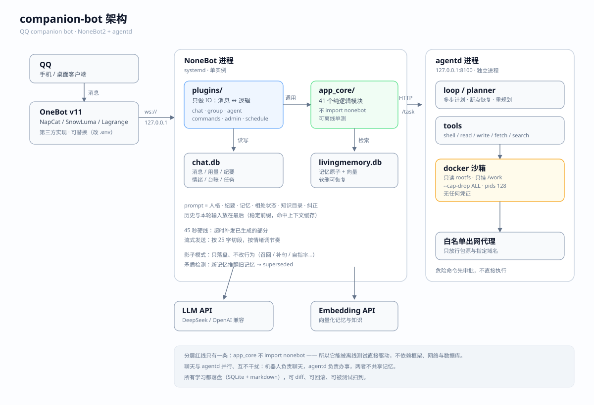

<div align="center">

# companion · a portable continuing subject

**Self-hosted and continuous across months: it remembers, knows when not to, and can finish small things you authorize.**
Memory is a resource, not its identity; channels, models and memory engines are replaceable.

[](https://github.com/Fqh22/companion-bot/actions/workflows/lint.yml)
[](LICENSE)
[](pyproject.toml)
[](#channels)

[Quick start](#quick-start) · [Architecture](#architecture) · [Channels](#channels) · [Docs](docs/README.md)

</div>

> **Unofficial project.** Not affiliated with Tencent, Feishu/Lark, or any IM platform.
> The QQ channel relies on third-party OneBot implementations (reverse-engineered protocol,
> ban risk) — run it on a throwaway account only. Personal WeChat is intentionally unsupported.

---

## What it is

A **portable, continuing companion subject**, not a chatbot bolted onto an LLM:

- **Restraint comes first**: did it hear you, did this go somewhere, was the dose right?
  Real companion traffic needs the past in only ~3.4% of messages; the hard part is knowing
  when *not* to retrieve, not to follow up, not to speak first.
- **Memory is a resource**: facts are traceable, contradictions adjudicated, and expression
  never contaminates what was recorded. It is consulted only when it should be.
- **The subject is portable**: persona, memories and relationship state export to human-readable,
  diffable, versionable files. Swap the model, channel or memory engine and it is still the same one.
- **It can act, with authorization**: short tasks (reminders, lookups, filing, sending) are in scope,
  but every side effect is traceable, reversible and authorized. No unsupervised planning.
- **Platforms are adapters**: no `import nonebot` inside `app_core`; self-hosted, secrets stay out of the repo.

It is **not** a multi-tenant platform, a plugin marketplace, a public web UI, or an unsupervised
multi-step executor. Nor does it chase human-like amnesia or distortion.
Current definition: [docs/22-项目定义.md](docs/22-项目定义.md).

## Features

| | |
|---|---|
| 🧠 **Long-term memory** | Summaries → structured facts → vector recall; explicit self-statements written immediately; archival after a threshold; contradiction detection soft-deletes stale facts; weekly "reflection" compresses facts into falsifiable insights |
| 🎭 **Mood & persona** | valence / baseline / energy; mood changes tone and length only; persona is a local file, hot-reloadable |
| 🗣 **Multi-channel** | QQ (OneBot v11), Feishu (self-built app + long connection), terminal; the same memory and persona across channels |
| 🎙 **Voice** | Two-way voice messages: ASR → turn → TTS (Zhipu primary, DeepSeek fallback); each channel transcodes on its own |
| 🛠 **Tools & commands** | 14 LLM tools, 17 commands; bounded tool rounds, 45 s hard deadline per turn |
| ⏰ **Scheduling** | Diary, review, cleanup, weekly reports; catch-up windows and missed-job audit; proactive messages only when there is a follow-up thread |
| 📈 **Observability** | `/status` aggregates alerts; failures land in `alerts.jsonl`; shadow experiments have criteria and deadlines; 5-minute health checks |
| 🧪 **Tests** | 735 offline checks, 280 smoke checks, 46 wiring checks, 7 plugins loaded; CI runs all 18 suites on every push |
| 💾 **Data & backup** | Daily consistent export, restore drills (real unzip + DB checks), pre-deploy code snapshots, checksums and rollback path |

## Architecture



```text
platform (QQ / Feishu / terminal / …)
   │  inbound
   ▼
adapters/          platform fields → InboundMessage (pure, testable offline)
   ▼
app_core/engine    one-turn facade
   ▼
app_core/chat      recall → prompt assembly → LLM → tool loop → segmentation → review
   ▼
app_core/runner    typing heartbeat, pacing, streaming, 45 s deadline, per-session lock
   ▼
Channel            send text / image / voice / typing
   ▼
platform
```

Inside the kernel there are three layers, enforced by `ops/lint-layers.py`
(see [docs/06-扩展与移植.md](docs/06-扩展与移植.md)):

| Layer | Responsibility | Examples |
|---|---|---|
| **domain** | pure rules, no IO | `prompt` `pacing` `delivery` `intent` `mood_domain` |
| **orchestration** | one turn, commands, scheduling | `engine` `runner` `chat` `commands` `scheduler` |
| **infra** | paths, config, files, clock | `paths` `config` `files` `kernel/*` |

Three hard rules, enforced by lint:

1. `app_core` never imports a platform framework;
2. a channel only declares capabilities and send primitives; the turn loop lives in `runner`;
3. plugins may only call whitelisted `CORE_API` facade methods.

## Quick start

No chat platform needed — talk to it in a terminal in five minutes. **Python 3.12** (CI tests it only).

```bash
git clone https://github.com/Fqh22/companion-bot.git
cd companion-bot

python -m venv .venv && source .venv/bin/activate
pip install -r nonebot/requirements.txt

export QQBOT_CODE_DIR=$PWD/nonebot
python ops/lint-plugins.py           # layering / style, seconds
python ops/test-nonebot-offline.py   # offline regression, no network
python ops/drill-console.py          # terminal channel: one real turn (temporary root)
```

For long-running deployment see [deploy](#deploy) below; for a new channel see
[docs/06-扩展与移植.md](docs/06-扩展与移植.md).

## Channels

| Channel | Status | How | Notes |
|---|---|---|---|
| **QQ / OneBot v11** | Works (risky) | Third-party OneBot implementation (SnowLuma / NapCat / Lagrange) | No official API for personal accounts; reverse-engineered; may break anytime |
| **Feishu / Lark** | Works | Self-built app + long connection (no public IP or domain needed) | Official open platform; owner-only private chat by default |
| **Terminal** | Built in | `ops/drill-console.py` | Debug/drill; reference implementation for new channels |
| WeCom / WeChat Official Account | Not supported | — | Official capabilities are too limited for a companion (48 h windows, etc.) |
| Personal WeChat | **Not supported** | — | No official API; injection/protocol bots violate ToS and get banned |

## Deploy

Target: a Linux server (the live instance is a 2 vCPU / 4 GB Tencent Cloud VM), systemd +
local SQLite, no GPU required.

```bash
ops/verify.sh --pre    # pre-restart: layers + offline + wiring, no production DB
ops/verify.sh          # full: adds end-to-end + plugin loading

# deploy from your machine (exports git HEAD; aborts before restart if verify fails)
export QQBOT_HOST=ubuntu@<server>
export QQBOT_KEY=/path/to/private-key.pem
bash ops/deploy.sh
```

The script snapshots the cloud code (rollback point), uploads `nonebot/` + `ops/`, restores
executable bits and writes `.deployed_sha`, runs `verify --pre`, restarts only on success,
then runs the full suite. Backup, restore drills and troubleshooting:
[docs/02-运维.md](docs/02-运维.md).

## Testing

| Suite | What | Size |
|---|---|---|
| Layering | syntax, dependency direction, command permission gates, new modules covered | seconds |
| Offline regression | behaviour, fully mocked, no network, no production DB | 735 |
| Wiring | plugin ↔ kernel call contracts | 46 |
| End-to-end smoke | every module exercised at least once | 280 |
| Plugin loading | all plugins really load | 7 |
| Real-clock smoke | no time mocking: decay, expiry, minute scheduling | separate |

```bash
ops/verify.sh                # the five suites
python ops/test-runner.py    # channel-agnostic loop: streaming / typing / timeout
python ops/test-commands.py  # parsing / permissions / registry
python ops/test-guards.py    # guard self-test: write a violation, expect lint to fail
```

## Documentation

Full map and reading paths: [**docs/README.md**](docs/README.md) (mostly Chinese).

## Known limitations

- Single user, single process; concurrency is serialized per session.
- QQ depends on third-party protocol implementations; it can break at any time.
- Voice only *speaks*; singing needs a separate singing/music-generation service.
- Memory retrieval embeddings currently have a single provider (Zhipu); voice already has a dual-provider fallback.
- Proactive messages currently go to QQ only; on Feishu it only replies.

## Contributing

Issues and PRs welcome. Read [CONTRIBUTING.md](CONTRIBUTING.md) and [AGENTS.md](AGENTS.md)
first: tests must be green, new behaviour needs a `check()`, and user-facing changes update
`docs/` and `CHANGELOG.md`.

## Security

See [SECURITY.md](SECURITY.md) for the secret inventory, secrets inside backups, and
third-party protocol risks.

## License

[MIT](LICENSE) © companion-bot contributors

- Not affiliated with Tencent, Feishu/Lark or any IM platform; names are used for compatibility only.
- QQ integrations rely on third-party OneBot implementations; usage risk is yours.
- Conversations and memories stay on your own server — back them up and restrict access.
