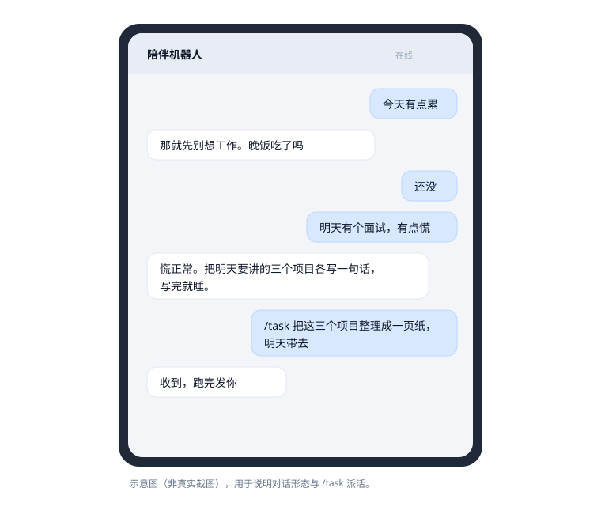
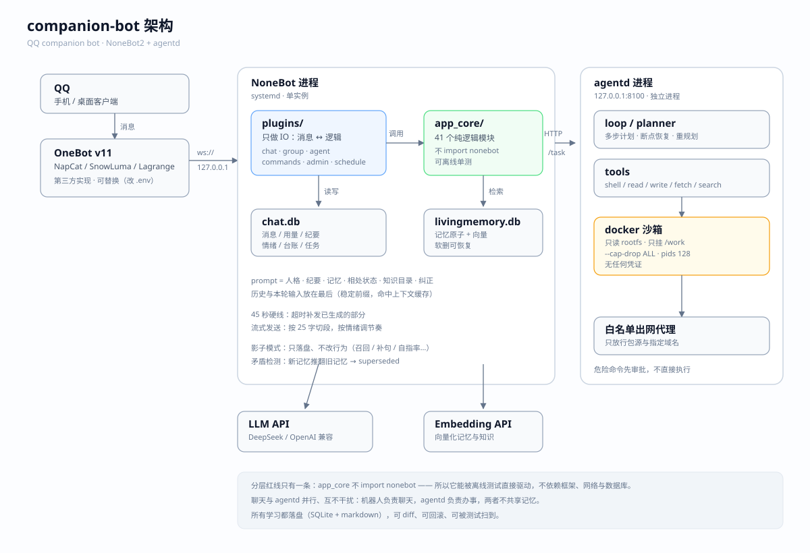

# companion-bot

> A self-hosted QQ companion bot with **long-term memory and mood**.

[中文](README.md) · Not affiliated with Tencent or QQ. Use at your own risk on your own deployment.

## What it is

One main path:

```
QQ → OneBot v11 → NoneBot2 (adapters / Engine / ChatCore)  instant replies, remembers you, has moods
```

- **Chat**: private messages, split into 18–32-char bubbles by mood (DeliveryPolicy can override), streams as it generates
- **Memory**: conversation → summary → structured facts → vector recall; used memories stay alive, idle ones get archived
- **Mood**: valence / baseline / energy, saturating impulses, composable decay; it only changes *how* it talks
- **Knowledge**: the bot writes its own notes with a shelf life; stale pages are flagged and audited weekly
- **Profile**: a six-field model of *you*, with confidence and a last-evidence timestamp; it expires
- **Contradiction check**: when a new fact replaces an old one, the old memory is soft-deleted



## Portability: QQ is just one channel

All business logic lives in `app_core` with **zero `import nonebot`**. A channel only has to
implement three primitives — send text, send image, typing — while the session loop
(streaming, pacing, 45s deadline) lives in `app_core/runner.py`.
Switching platforms takes 3–5 days (NoneBot adapter) or 1–2 weeks (no NoneBot), with no
business-code changes. See [docs/06-移植指南.md](docs/06-移植指南.md) (Chinese).

## Architecture



One layering rule: **`app_core` never imports nonebot**. QQ/console enter through `adapters`
and an `Engine` facade, so the core stays testable offline without a framework, network, or database.

## Quick start (no QQ needed)

Python **3.12** (the only version CI tests; `requirements.txt` is pinned for 3.12).

```bash
python -m venv .venv && . .venv/bin/activate
pip install -r nonebot/requirements.txt

export QQBOT_CODE_DIR=$PWD/nonebot
python ops/lint-plugins.py          # layering & conventions (pure AST, instant)
python ops/test-nonebot-offline.py  # offline suite: no network, LLM and embeddings mocked
```

If it prints `全部通过`, the code is self-consistent on your machine.


The offline suite has **647 tests**. A few cases print **SKIP** when the production DB
copy is empty (no documents/vectors); with real data they all run.

## Path convention

The runtime root defaults to `/opt` and can be overridden with `QQBOT_ROOT`:

```bash
export QQBOT_ROOT=/srv/qqbot      # default: /opt
```

Everything derives from it in `nonebot/app_core/paths.py`:

| Path | Contents |
|---|---|
| `$QQBOT_ROOT/nonebot/data` | `chat.db`, persona, shadow logs, prompt snapshots |
| `$QQBOT_ROOT/qqbot-data` | memory DB, `keys.json`, learn material |
| `$QQBOT_ROOT/backup` | backups |

The offline suite redirects every path into a temp dir, so it is unaffected.
## Connect to QQ

1. Run an OneBot v11 implementation (NapCat / SnowLuma / Lagrange …) pointing at the reverse-WS port
2. `cp nonebot/.env.example nonebot/.env`, set `ONEBOT_ACCESS_TOKEN` and `SUPERUSERS`
3. `cp nonebot/config.example.yaml nonebot/config.yaml`, then set at least:
   - `admin.user_id` — your QQ number; add `admin.identities` for extra entry points. **If both are empty, memories are not written and proactive messages are off**
   - `llm.api` / `llm.model` and the embedding endpoint
4. Put API keys in `/opt/qqbot-data/keys.json` (mode 600)
5. `cd nonebot && python bot.py`

See [docs/02-运维.md](docs/02-运维.md) for deployment, backup and troubleshooting (Chinese).

## Layout

```
nonebot/
├─ app_core/     pure-logic modules (no nonebot import, ~45 files)
├─ adapters/     qq / console / fake channel adapters
├─ companion_core/ stable entry (EngineConfig + create_engine)
├─ plugins/      6 plugins: chat / group / commands / admin / schedule / proactive
└─ personas/     persona for strangers (private chat)
docs/            system, ops, link matrix (Chinese)
ops/             verification and ops scripts (deployed to /opt/nonebot/ops)
templates/plugin/  new-plugin scaffold
```

## Design decisions worth knowing

1. **app_core is pure logic** — plugins only do IO; every rule lives in a testable function.
2. **Prompt has a stable prefix** — persona/guide/profile/digest first, history and dynamic context later,
   so the provider's context cache hits. The exact split is `chat.context_format` (default `compact`).
3. **45-second deadline** — if generation is slow, send what exists instead of making the user wait.
4. **Mood is state, not a counter** — three values with lazy decay; changing the dynamics means
   recalibrating every downstream threshold (a documented pitfall).
5. **Everything learned is persisted** — memory, corrections, profile, skills are files/SQLite;
   they can be diffed, rolled back, and audited.
6. **Quiet by default** — proactive messages are gated, groups are disabled, silence beats spam.

## Non-goals

- Single user, single process, single machine — not a multi-tenant service
- Group chats are off by default; when on, only @mentions are answered and nothing enters memory
- no multi-step task/sandbox execution; companion chat is the only main path
- No multi-agent parallelism, no browser automation, no local models
- Sandbox state is not persisted (pip takes seconds to reinstall)

## External dependency and risks

QQ has no official bot API for personal accounts. Access goes through an OneBot v11 implementation
(NapCat / SnowLuma / Lagrange …), which **reverse-engineers QQ's private protocol or hooks the official
client**. It is not a stable contract:

- **It can break at any time** — a protocol change or a new risk-control rule takes the whole link down.
  go-cqhttp used to be the de-facto standard and is now barely maintained; the community moved to NapCat.
- **Swapping implementations is cheap** — OneBot v11 is a de-facto standard, so switching means editing the
  WS URL and token in `nonebot/.env`. `app_core` and `plugins` stay untouched.
- **Account bans are possible** — a ToS matter that no code can prevent. **Run it on a secondary account.**
- **Disconnects are visible** — the health check probes login state every 5 minutes and alerts on repeated failure.

If that is not acceptable, this project is not a fit — it is not something configuration can solve.
## Tests

```bash
ops/verify.sh            # five suites: layering / offline / link / end-to-end / plugins
ops/verify.sh --pre      # before restart: never touches the production DB
ops/verify.sh --quick    # seconds: layering + link check
```

The link check actually boots nonebot and drives the plugin handlers, asserting **call counts and
arguments** — not just "it didn't crash". See [docs/04-联动矩阵.md](docs/04-联动矩阵.md) for which
link is guarded by which test (Chinese).

## License

[MIT](LICENSE)
