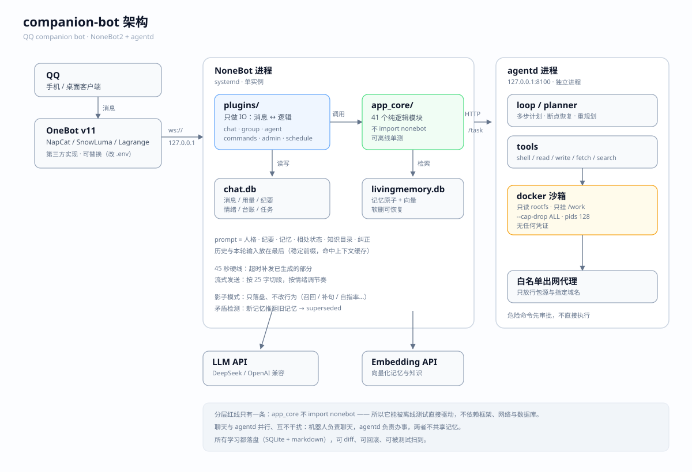

<div align="center">

# 记忆体 · companion

**自托管的长期记忆陪伴体：记得住、有情绪。**
对话只是它的端口，不是它的本体。

[](https://github.com/Fqh22/companion-bot/actions/workflows/lint.yml)
[](LICENSE)
[](pyproject.toml)
[](#通道)

[快速开始](#快速开始) · [架构](#架构) · [通道](#通道) · [部署](#部署) · [文档](docs/README.md)

</div>

> **非官方项目**：与腾讯、飞书及任何 IM 平台无隶属关系。QQ 通道依赖第三方 OneBot 实现，
> 存在协议失效与账号风控风险，请仅用独立小号自用；个人微信不做支持（见[已知限制与路线图](#已知限制与路线图)）。

---

## 它是什么

一个**长期记忆体**，不是"接在大模型前面的聊天机器人"：

- **记忆是主链路**：每轮对话被总结成结构化事实 → 向量化 → 需要时召回；
  说过的话有去处，久不用的记忆会被归档而不是消失。
- **表达是端口**：情绪、人格、节奏、分段、语音都只影响"怎么说"，不影响"记得什么"。
- **平台是适配层**：`app_core` 里没有一行 `import nonebot`，QQ / 飞书 / 终端都只是通道。
- **单用户、自托管**：跑在自己的服务器上，数据在本地 SQLite，密钥不进仓库。

它**不是**：多用户平台、公开 Web 界面、多 agent 编排、多步任务执行器。
也**不追求**"更像人"的健忘——记忆层要求精确、可溯源、矛盾可裁决。

## 一段对话

> 示例（已脱敏）

| 他 | 它 |
|---|---|
| 今天累死了 | 那就别撑着了。饭吃了没 |
| 上次说的 2K 那事，你查了吗 | 查了。DCI 的 2K 是 2048×1080；消费级把 2560×1440 也叫 2K，叫法本身就不统一。 |
| 算了不弄了 | 行，先放着。 |

## 特性

| | |
|---|---|
| 🧠 **长期记忆** | 总结 → 结构化事实 → 向量召回；即时写入明确自述；超过阈值才归档，矛盾时软删旧事实；周度"反思"把零散事实压成可被否定的判断 |
| 🎭 **情绪与人格** | 心情 / 基线 / 精力三值；情绪只改语气与长度，不污染事实；人格是本地文件，可热重载 |
| 🗣 **多通道** | QQ（OneBot v11）、飞书（自建应用 + 长连接）、终端调试通道；同一套记忆与人格跨端连续 |
| 🎙 **语音** | 语音消息双向：ASR 转写 → 对话 → TTS 合成（智谱主用、DeepSeek 兜底），飞书/QQ 各自转码发送 |
| 🛠 **工具与命令** | 14 个 LLM 工具（搜索、天气、提醒、文件、画图…）、17 条命令；工具轮数有上限，整轮 45 秒硬线 |
| ⏰ **调度与主动消息** | 日记、复盘、清理、周报；任务带补跑窗口与缺跑审计；主动消息只在"有话头"时开口 |
| 📈 **可观测** | `/status` 汇总告警；失败分支进入 `alerts.jsonl`；影子实验带判据与截止日期；每 5 分钟健康检查 |
| 🧪 **测试** | 离线回归 735 项、全链路 280 项、联动体检 46 项、7 个插件真实加载；CI 每次推送执行全部 18 套 |
| 💾 **数据与备份** | 每日一致性导出、恢复演练（真解压真查库）、部署前代码快照、校验和回滚路径 |

## 架构



```text
platform (QQ / Feishu / terminal / …)
   │  收消息
   ▼
adapters/          平台字段 → InboundMessage（纯函数，可离线测）
   ▼
app_core/engine    一轮对话的门面
   ▼
app_core/chat      记忆召回 → prompt 组装 → LLM → 工具循环 → 分段 → 复盘
   ▼
app_core/runner    typing 心跳、节奏、流式发送、45 秒硬线、同会话串行
   ▼
Channel            发文本 / 发图 / 发语音 / typing
   ▼
platform
```

内核内部再分三层，由 `ops/lint-layers.py` 强制（详见 [docs/06-扩展与移植.md](docs/06-扩展与移植.md)）：

| 层 | 职责 | 例子 |
|---|---|---|
| **domain** | 纯规则，不碰 IO | `prompt` `pacing` `delivery` `intent` `mood_domain` |
| **orchestration** | 一轮对话、命令、调度 | `engine` `runner` `chat` `commands` `scheduler` |
| **infra** | 路径、配置、文件、时钟 | `paths` `config` `files` `kernel/*` |

三条硬约束（lint 守，不靠自觉）：

1. `app_core` 不 import 任何平台框架；
2. 通道只实现能力声明 + 发送原语，会话循环统一在 `runner`；
3. 插件只能调用 `CORE_API` 白名单里的门面方法。

## 快速开始

不需要任何聊天平台，5 分钟在终端里和它聊一轮。**Python 3.12**（CI 只测这一版）。

```bash
git clone https://github.com/Fqh22/companion-bot.git
cd companion-bot

python -m venv .venv && source .venv/bin/activate      # Windows: .venv\Scripts\activate
pip install -r nonebot/requirements.txt

export QQBOT_CODE_DIR=$PWD/nonebot
python ops/lint-plugins.py           # 分层/规范，秒级
python ops/test-nonebot-offline.py   # 离线回归，不联网
python ops/drill-console.py          # 终端通道：直接和它聊一轮（临时根，不碰生产库）
```

想让它长期运行，先看[部署](#部署)；想接新通道，看[接入一个通道](#接入一个通道)。

## 通道

| 通道 | 状态 | 接入方式 | 说明 |
|---|---|---|---|
| **QQ / OneBot v11** | 可用（有风险） | 第三方 OneBot 实现（SnowLuma / NapCat / Lagrange） | 无官方个人号 API，逆向协议，可能随时失效；建议小号 |
| **飞书** | 可用 | 企业自建应用 + 长连接（无需公网 IP / 域名） | 官方开放平台；默认只和主人私聊 |
| **终端** | 内置 | `ops/drill-console.py` | 调试/演练；新通道的参考实现 |
| 企业微信 / 微信公众号 | 未支持 | — | 官方能力受限（客服 48 小时窗口等），不适合陪伴场景 |
| 个人微信 | **不做** | — | 无官方接口，注入/协议方案违规且封号风险高 |

### 接入一个通道

实现一个能力声明和发送原语，把事件转成 `InboundMessage`，剩下的交给 `TurnRunner`：

```python
class Channel:
    forms = {"text", "image", "voice"}          # 这个平台支持什么

    async def send_part(self, session: str, part) -> bool: ...
    async def typing(self, session: str, on: bool) -> None: ...

async def on_message(platform_msg):
    msg = InboundMessage(session=f"myplat:{platform_msg.user_id}",
                         text=platform_msg.text, images=platform_msg.images,
                         platform="myplat")
    await TurnRunner(engine, MyChannel(), deadline=45).run(msg)
```

记忆、情绪、prompt、分段、45 秒硬线、命令、调度全部复用。
完整步骤与「五条扩展路径」见 [docs/06-扩展与移植.md](docs/06-扩展与移植.md)。

## 配置与密钥

- **运行时根**：默认 `/opt`，用 `QQBOT_ROOT` 覆盖（`app_core/paths.py` 统一派生）。
- **`nonebot/config.yaml`**：模型、阈值、通道开关等；模板见 [nonebot/config.example.yaml](nonebot/config.example.yaml)。可视化编辑见 [docs/05-配置界面.md](docs/05-配置界面.md)。
- **`<root>/qqbot-data/keys.json`**：DeepSeek / 智谱 / GitHub / 飞书 App 凭证，权限 600，**不入库、不随部署传输**。
- **`nonebot/.env`**：OneBot access token、SUPERUSERS，**不入库**。

密钥处理规则见 [SECURITY.md](SECURITY.md)；提交前可装 `ops/git-hooks/pre-commit` 自动扫描。

## 部署

目标环境：一台 Linux 服务器（本项目线上是腾讯云 2C4G），systemd + 本地 SQLite，不需要 GPU。

```bash
# 云端验证五件套（不在 CI 覆盖的部分）
ops/verify.sh --pre    # 重启前：分层 + 离线 + 联动，不碰生产库
ops/verify.sh          # 全量：再加全链路 + 插件启动

# 部署（本地执行，从 git HEAD 导出，验证不过不重启）
export QQBOT_HOST=ubuntu@<server>
export QQBOT_KEY=/path/to/private-key.pem
bash ops/deploy.sh
```

部署脚本会：云端打代码快照（回滚点）→ 上传 `nonebot/` + `ops/` → 恢复脚本可执行位、
写入 `.deployed_sha` → `verify --pre` 通过才重启 → 重启后跑全量验证。
备份、恢复演练、排障手册见 [docs/02-运维.md](docs/02-运维.md)。

## 测试

没有"感觉没问题"，只有跑过：

| 套件 | 内容 | 当前规模 |
|---|---|---|
| 分层检查 | 语法、分层方向、命令权限门、新模块进体检 | 秒级 |
| 离线回归 | 行为正确性，全 mock、不联网、不碰生产库 | 735 项 |
| 联动体检 | 插件 ↔ 内核的调用契约 | 46 项 |
| 全链路 | 每个模块至少跑通一次 | 280 项 |
| 插件启动 | 真实加载全部插件 | 7 个 |
| 真实时钟冒烟 | 不 mock 时间：衰减、过期、整分调度 | 单独跑 |

```bash
ops/verify.sh                # 五件套
python ops/test-runner.py    # 通道无关层：流式 / typing / 超时 / 补发
python ops/test-commands.py  # 命令解析 / 权限 / 注册表
python ops/test-guards.py    # 护栏自检：故意写违规，确认 lint 真的会红
```

"哪条链路坏了会被哪个测试发现"见 [docs/04-联动矩阵.md](docs/04-联动矩阵.md)。

## 项目结构

```text
companion-bot/
├─ nonebot/
│  ├─ app_core/           # 业务内核（83 个模块；不 import 任何平台框架）
│  │  ├─ chat.py          # 一轮对话的总枢纽
│  │  ├─ memory*.py       # 记忆：存储 / 索引 / 召回 / 契约
│  │  ├─ prompt.py        # 稳定前缀 + 易变区组装
│  │  ├─ tools.py         # 14 个 LLM 工具（schema + handler）
│  │  └─ scheduling/      # 内建定时任务
│  ├─ adapters/           # 平台字段 → InboundMessage
│  ├─ plugins/            # 宿主胶水：chat / commands / feishu / …
│  ├─ companion_core/     # 框架无关门面包（pip 可装）
│  └─ config.example.yaml
├─ ops/                   # 测试、运维、部署、备份（每个脚本可独立跑）
├─ docs/                  # 文档索引见 docs/README.md
└─ pyproject.toml         # 内核包 companion-core
```

## 文档

完整地图与阅读路径：[**docs/README.md**](docs/README.md)

| 想了解 | 读 |
|---|---|
| 项目定义、设计初衷 | [docs/09-设计初衷.md](docs/09-设计初衷.md) |
| 系统消息流、数据布局 | [docs/01-系统.md](docs/01-系统.md) |
| 部署、备份、排障 | [docs/02-运维.md](docs/02-运维.md) |
| 分层与扩展（加通道/工具/命令） | [docs/06-扩展与移植.md](docs/06-扩展与移植.md) |
| 已定决策与取舍 | [docs/10-设计决策.md](docs/10-设计决策.md) |
| 飞书通道 | [docs/20-飞书通道.md](docs/20-飞书通道.md) |

## 已知限制与路线图

**限制**

- 单用户、单进程：并发靠会话锁串行，不做多租户。
- QQ 通道依赖第三方协议实现，随时可能失效；个人微信不提供支持。
- 语音只做"说"，不做"唱"（唱歌需要另接歌声合成/音乐生成服务）。
- 记忆检索的 embedding 目前单点（智谱）；语音已做双 provider 互备。
- 主动消息目前只走 QQ，飞书侧只有"你发它回"。

**路线图**

- [x] 通道抽象 + 终端/QQ 双实现
- [x] 记忆契约（MemoryPort）、矛盾检测、反思洞察
- [x] 部署/备份/恢复演练自动化
- [x] 飞书通道（长连接，私聊）
- [ ] 飞书主动消息
- [ ] embedding 兜底与切换
- [ ] 可选的歌声合成（独立服务，非 TTS）

## 参与贡献

欢迎 issue / PR。动手前请读 [CONTRIBUTING.md](CONTRIBUTING.md) 与
[AGENTS.md](AGENTS.md)（分层红线、五条扩展路径、提交前检查）。改动需要：

1. 测试全绿（本地 `ops/verify.sh` 或 CI）；
2. 新行为配一条 `check()`；
3. 对外行为/配置变化同步 `docs/` 与 `CHANGELOG.md`。

## 安全

- 密钥清单、备份中的密钥、第三方协议风险：见 [SECURITY.md](SECURITY.md)。
- 发现漏洞请勿公开 issue，按 SECURITY.md 的方式私密报告。

## 许可证与声明

[MIT](LICENSE) © companion-bot contributors

- 本项目与腾讯、飞书及任何 IM 平台无隶属关系，平台名称仅用于说明兼容性。
- QQ 相关接入依赖第三方 OneBot 实现，使用风险与合规责任由使用者自行承担。
- 对话内容与记忆数据保存在使用者自己的服务器上；请自行做好备份与访问控制。
