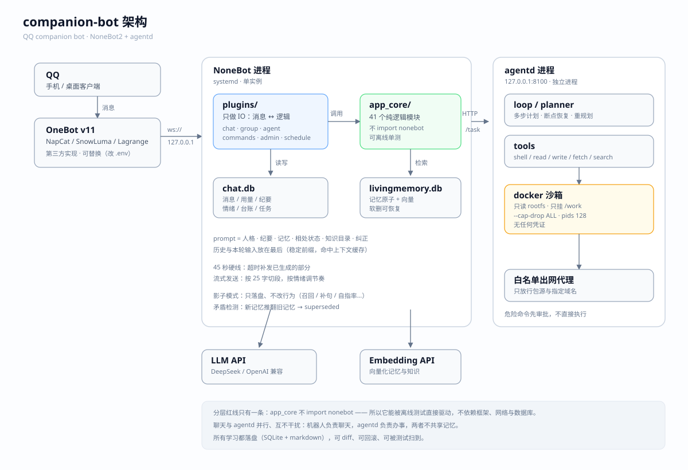

# 记忆体 · companion

> 一个自托管的长期记忆体：记得住、有情绪。
> 对话只是它的端口，不是它的本体。

非腾讯官方项目，与腾讯 / QQ 无任何关联，仅用于个人自建。

## 一段对话

> 示例（已脱敏）

**他**：今天累死了
**它**：那就别撑着了。饭吃了没

**他**：上次说的 2K 那事，你查了吗
**它**：查了。DCI 的 2K 是 2048×1080；消费级把 2560×1440 也叫 2K，叫法本身就不统一。

**他**：算了不弄了
**它**：行，先放着。

## 是什么

**内核 + 适配层**。三个设计约束：

1. 内核不懂平台：`app_core` 没有一行 `import nonebot`，由 lint 守着。
2. 通道只做三个原语：发文本、发图、typing；会话循环由内核统一。
3. 换通道不改业务：记忆、情绪、prompt、分段、命令、调度全部复用。



## 设计理念：似人，但不是人

表达像人：有情绪、有停顿、会主动。记忆不像人：不失真、不遗忘、不记仇。
情绪影响语气，不影响事实。

定义与决策判据见 [docs/09-设计初衷.md](docs/09-设计初衷.md)。

## 分层

规则由 `ops/lint-layers.py` 强制，详见 [docs/07-分层.md](docs/07-分层.md)：

| 层 | 职责 | 例子 |
|---|---|---|
| **domain** | 纯规则，不碰 IO | `prompt` `pacing` `delivery` `intent` |
| **orchestration** | 编排一轮对话 / 命令 / 调度 | `engine` `runner` `commands` `runtime` |
| **infra** | 路径、配置、文件、时钟 | `paths` `config` `files` `kernel/*` |

## 接入一个通道

实现三个原语，然后接线：

```python
class Channel:
    async def send_text(self, session: str, text: str) -> bool: ...
    async def send_image(self, session: str, path: str) -> bool: ...
    async def typing(self, session: str, on: bool) -> None: ...

async def on_message(platform_msg):
    msg = InboundMessage(
        session=f"myplat:{platform_msg.user_id}",
        text=platform_msg.text,
        images=platform_msg.images,
        platform="myplat",
    )
    await TurnRunner(engine, MyChannel(), deadline=45).run(msg)
```

命令用现成的注册表：`registry = default_registry(engine.core)`，然后 `registry.dispatch("/mood", ctx)`。

记忆、情绪、prompt、分段、45 秒硬线、只读命令全部复用。完整说明见 [docs/06-移植指南.md](docs/06-移植指南.md)。

## 快速开始（不需要任何平台）

Python **3.12**（CI 只测这个版本）。

```bash
python -m venv .venv && . .venv/bin/activate
pip install -r nonebot/requirements.txt
export QQBOT_CODE_DIR=$PWD/nonebot
python ops/lint-plugins.py
python ops/test-nonebot-offline.py
```

直接和它聊：`python ops/drill-console.py`（终端通道，临时根，不碰生产库）。

## 适配层

| 适配层 | 文件 | 说明 |
|---|---|---|
| console | `nonebot/adapters/console.py` | 终端；新通道的参考实现 |
| QQ / OneBot v11 | `nonebot/adapters/qq.py` + `nonebot/plugins/` | 通过 SnowLuma / NapCat 等接入 |

QQ 没有个人号官方 API，依赖逆向协议的 OneBot 实现，可能随时失效（2026-11 已有实现收到律师函）。
所以它被放在最外层：失效时替换适配层，内核不变。接入步骤见 [docs/02-运维.md](docs/02-运维.md)。

## 能力

- **聊天**：流式生成，按情绪切 18–32 字分段，45 秒硬线
- **记忆**：总结 → 结构化事实 → 向量召回；用过续命，长期不用才归档
- **情绪**：心情 / 基线 / 精力三值，只影响「怎么说」
- **知识库**：自写笔记，带保质期，过期标注
- **画像**：复盘时更新，带置信度与最后证据时间
- **矛盾检测**：新事实推翻旧事实时软删
- **调度**：日记、复盘、清理、周报；带补跑与缺跑审计
- **主动消息**：只在有 followup 话头时开口

## 数据

根目录默认 `/opt`，用 `QQBOT_ROOT` 覆盖（`app_core/paths.py` 统一派生）：

| 路径 | 内容 |
|---|---|
| `$QQBOT_ROOT/nonebot/data` | `chat.db`、人格、影子日志、prompt 快照 |
| `$QQBOT_ROOT/qqbot-data` | 记忆库、`keys.json`、学习资料 |
| `$QQBOT_ROOT/backup` | 备份 |

`config.yaml` 与 `keys.json` 不入库；模板见 `nonebot/config.example.yaml`。

## 测试

```bash
ops/verify.sh          # 五件套：分层 / 离线 / 联动 / 全链路 / 插件
ops/test-runner.py     # 通道无关层：流式 / typing / 超时 / 补发
ops/test-commands.py   # 命令解析 / 权限 / 默认注册表
ops/drill-console.py   # 断线演练：没有 QQ 也能跑一轮真实对话
```

## 文档

| 想了解 | 读 |
|---|---|
| 项目定义与决策判据 | [docs/09-设计初衷.md](docs/09-设计初衷.md) |
| 从对话中心迁到记忆契约 | [docs/10-重构方案.md](docs/10-重构方案.md) |
| 内核分层、新模块放哪 | [docs/07-分层.md](docs/07-分层.md) |
| 加模块 / 通道 / 命令 / 工具 / 任务 | [docs/08-扩展指南.md](docs/08-扩展指南.md) |
| 消息流、数据布局 | [docs/01-系统.md](docs/01-系统.md) |
| 部署、备份、排障 | [docs/02-运维.md](docs/02-运维.md) |
| 哪条链路坏了会被哪个测试发现 | [docs/04-联动矩阵.md](docs/04-联动矩阵.md) |
| 换掉 QQ、移植到别的平台 | [docs/06-移植指南.md](docs/06-移植指南.md) |

## License

[MIT](LICENSE)
