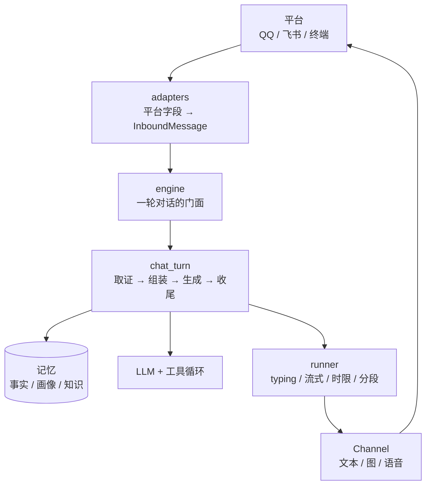

<div align="center">

# companion

**它只服务一个人。跨月记得你，也知道什么时候该闭嘴。**

自托管 · 单进程 · 本地 SQLite · 换模型换通道仍是它

[](https://github.com/Fqh22/companion-bot/actions/workflows/lint.yml)
[](LICENSE)
[](pyproject.toml)

[快速开始](#五分钟跑起来) · [它怎么工作](#它怎么工作) · [接一个通道](#接一个通道) · [文档](#文档)

</div>

> **非官方项目**：与腾讯、飞书及任何 IM 平台无隶属关系。QQ 通道依赖第三方 OneBot 实现，
> 存在协议失效与账号风控风险，请只用独立小号自用；个人微信不做支持。

---

## 它是什么

**不是"接在大模型前面的聊天机器人"，也不是角色扮演。**

大多数"AI 陪伴"的做法是：每轮都检索、把十条记忆塞进 prompt、让模型更懂你。
实测下来这条路是错的——真实陪伴对话里只有约 **3.4%** 的消息真的需要回忆，
而检索门控的判别力（AUROC 0.530）接近抛硬币。**更准的检索救不了"什么时候不该检索"。**

所以它的第一支柱是**判断**，不是记忆：

| | 聊天机器人 | 它 |
|---|---|---|
| 每轮做什么 | 检索 → 拼上下文 → 回答 | 先判断这轮要不要回忆、要不要追问、要不要开口 |
| 记忆的位置 | prompt 里的素材 | 被调用的资源；事实可追溯、矛盾可裁决 |
| 说与不说 | 尽量多说 | 真正的接住包含「不接」 |

三句话概括它的取舍：

- **判断**：听见了吗、有去处吗、剂量对吗。
- **记忆**：说出口的表达不污染记下的事实；只在该用的时候翻。
- **出场**：文字 / 语音 / 图 / 表情都是「形式」，形式本身携带意图。

再加两条工程约束：

- **可携带**：人格、记忆、关系状态能导出成人类可读、可 diff 的文件；换模型、换通道、换记忆引擎，还是它。
- **可授权**：提醒、查资料、整理、发消息这类小事能办完，但每次副作用可追溯、可回滚、需授权；不做无人监督的多步执行。

它**不做**：多租户、插件市场、公网 Web 界面、无人监督的自主规划、以及"更像人"的静默遗忘与失真。
完整的定义、五条判据与历史沿革见 [docs/01-定义与决策.md](docs/01-定义与决策.md)。

---

## 它怎么工作

### 一轮对话



- **取证**：天气、搜索、待办、召回想并行跑，受首字预算约束；
- **组装**：稳定前缀（画像）在前、历史在中、【背景】块（记忆/笔记/纠正）在后——为了缓存命中，也为了不让前缀每轮变化；
- **生成**：模型优先，规则只兜底；工具最多 6 轮，预算从首字派生；
- **收尾**：写历史、旁注（"我刚发了语音"）、影子样本、复盘水位；顺序不能换。

时限是**实现细节**，不是定义：总上限 90 秒只防「永远不结束」，真正约束体感的是首字预算 10 秒 + 无进展超时 30 秒。

### 记忆

写入有两个时机：**明确的自我陈述立刻落库**（不等批量总结），批量总结每 8 轮 / 40 条 / 闲置 30 分钟一次。
事实带来源与时间，矛盾时**软删旧事实**而不是覆盖；超过重要度阈值才归档，不物理删除。
周度反思把零散事实压成一条可被用户否定的「理解」——这是记忆唯一的纠错入口。

### 通道只是适配层

`app_core` 里没有一行 `import nonebot`。通道只声明支持的形式（`forms`）和两个发送原语；
会话循环、记忆、情绪、分段、时限、命令、调度全部复用。

---

## 五分钟跑起来

不需要任何聊天平台，在终端里和它聊一轮。**Python 3.12**（CI 只测这一版）。

```bash
git clone https://github.com/Fqh22/companion-bot.git
cd companion-bot
python -m venv .venv && source .venv/bin/activate      # Windows: .venv\Scripts\activate
pip install -r nonebot/requirements.txt

export QQBOT_CODE_DIR=$PWD/nonebot
python ops/lint-plugins.py           # 分层/规范，秒级
python ops/drill-console.py          # 终端通道：临时根，不碰生产库
```

想让它长期在线，看 [部署](#部署)；想接自己的通道，看下一节。

---

## 接一个通道

实现「能力声明 + 发送原语」，把平台事件转成 `InboundMessage`，剩下的交给 `TurnRunner`：

```python
class MyChannel:
    forms = {"text", "image", "voice"}            # 这个平台支持什么

    async def send_part(self, session: str, part) -> bool: ...
    async def typing(self, session: str, on: bool) -> None: ...

async def on_message(platform_msg):
    msg = InboundMessage(session=f"myplat:{platform_msg.user_id}",
                         text=platform_msg.text, images=platform_msg.images,
                         platform="myplat")
    await TurnRunner(engine, MyChannel(), deadline=90).run(msg)
```

QQ（OneBot v11）、飞书（自建应用长连接）、终端三个实现共用同一套记忆与人格；
完整步骤见 [docs/02-系统与扩展.md](docs/02-系统与扩展.md)，通道配置见 [docs/03-运维与通道.md](docs/03-运维与通道.md)。

---

## 改它

分层由 `ops/lint-layers.py` 强制，不靠自觉：

| 层 | 职责 | 例子 |
|---|---|---|
| **domain** | 纯规则，不碰 IO | `prompt` `pacing` `delivery` `intent` |
| **orchestration** | 一轮对话、命令、调度 | `engine` `runner` `chat` `chat_turn` |
| **infra** | 路径、配置、文件、时钟 | `paths` `config` `files` `kernel/*` |

四条硬约束（每条都有检查，违反即红）：`app_core` 不 import 平台框架；
domain 不依赖编排层；插件只走 `core.<ns>.<func>` 门面；新模块必须声明层。

加东西的入口只有五个：业务模块、通道、命令、LLM 工具、定时任务——详见
[AGENTS.md](AGENTS.md) 与 [docs/02-系统与扩展.md](docs/02-系统与扩展.md)。

---

## 部署

一台 Linux 服务器，systemd + 本地 SQLite，不需要 GPU（线上是 2C4G）。

```bash
ops/verify.sh --pre    # 重启前：规范 / 分层 / 配置同步 / 离线 / 复盘基线 / 骨架 / 联动
ops/verify.sh          # 全量：再加全链路与插件启动

export QQBOT_HOST=ubuntu@<server>
export QQBOT_KEY=/path/to/key.pem
bash ops/deploy.sh     # 云端快照 → 上传 → pre 验证过了才重启 → 全量验证
```

密钥不入库、不随部署传输；备份、恢复演练、排障见 [docs/03-运维与通道.md](docs/03-运维与通道.md)
与 [SECURITY.md](SECURITY.md)。

---

## 验证

没有"感觉没问题"，只有跑过。CI 每次推送执行全部套件：

| 套件 | 内容 | 规模 |
|---|---|---|
| 规范 / 分层 | 语法、依赖方向、插件门面、配置同步 | 秒级 |
| 离线回归 | 行为正确性，全 mock、不联网、不碰生产库 | 735 项 |
| 复盘基线 | 复盘落盘的逐字节 diff | 7 个文件 |
| 联动体检 | 插件 ↔ 内核的调用契约 | 秒级 |
| 全链路 | 每个模块至少跑通一次 | 288 项 |
| 插件启动 | 真实加载全部插件 | 7 个 |

`ops/verify.sh` 在云端把它们串成 9 套；本地跑 `ops/test-guards.py` 可以确认护栏本身没有失效。

---

## 文档

四篇，按「读完之后能做什么」分：

| 想做什么 | 读 |
|---|---|
| 理解它是什么、边界在哪、为什么这么取舍 | [01-定义与决策](docs/01-定义与决策.md) |
| 改代码：消息怎么走、三层红线、加东西的路径 | [02-系统与扩展](docs/02-系统与扩展.md) |
| 部署、备份、排障、接通道 | [03-运维与通道](docs/03-运维与通道.md) |
| 评测：怎么知道改好了、影子实验与未落地设计 | [04-评测与实验](docs/04-评测与实验.md) |

地图与阅读路径见 [docs/README.md](docs/README.md)；逐批改动在 [CHANGELOG.md](CHANGELOG.md)
（流水，不需要通读）。

---

## 已知限制

- 单用户、单进程：并发靠会话锁串行，不做多租户。
- QQ 通道依赖第三方协议实现，随时可能失效；个人微信不提供支持。
- 语音只做"说"，不做"唱"。
- 记忆检索的 embedding 目前单点（智谱）；语音已双 provider 互备。
- 飞书侧主动消息已接，但只在你跟它说过话之后才有会话映射。

---

## 许可证与声明

[MIT](LICENSE) © companion-bot contributors

- 与腾讯、飞书及任何 IM 平台无隶属关系，平台名称仅用于说明兼容性。
- QQ 接入依赖第三方 OneBot 实现，使用风险与合规责任由使用者承担。
- 对话与记忆数据保存在你自己的服务器上；请自行做好备份与访问控制。
